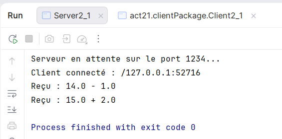
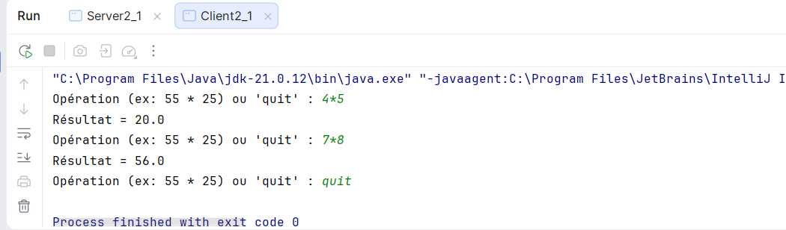

TP 2 : Les sockets en mode connecté TCP : E/R de CC & objets
Activité 2-1 : Échange de CC entre Client/Serveur via les Sockets TCP
Application des flux de traitement de CC:
lancer server:

lancer Client:

TP 2 : Les sockets en mode connecté TCP : E/R de CC & objets
Activité 2-2 : Échange des objets entre Client/Serveur via les Sockets TCP

